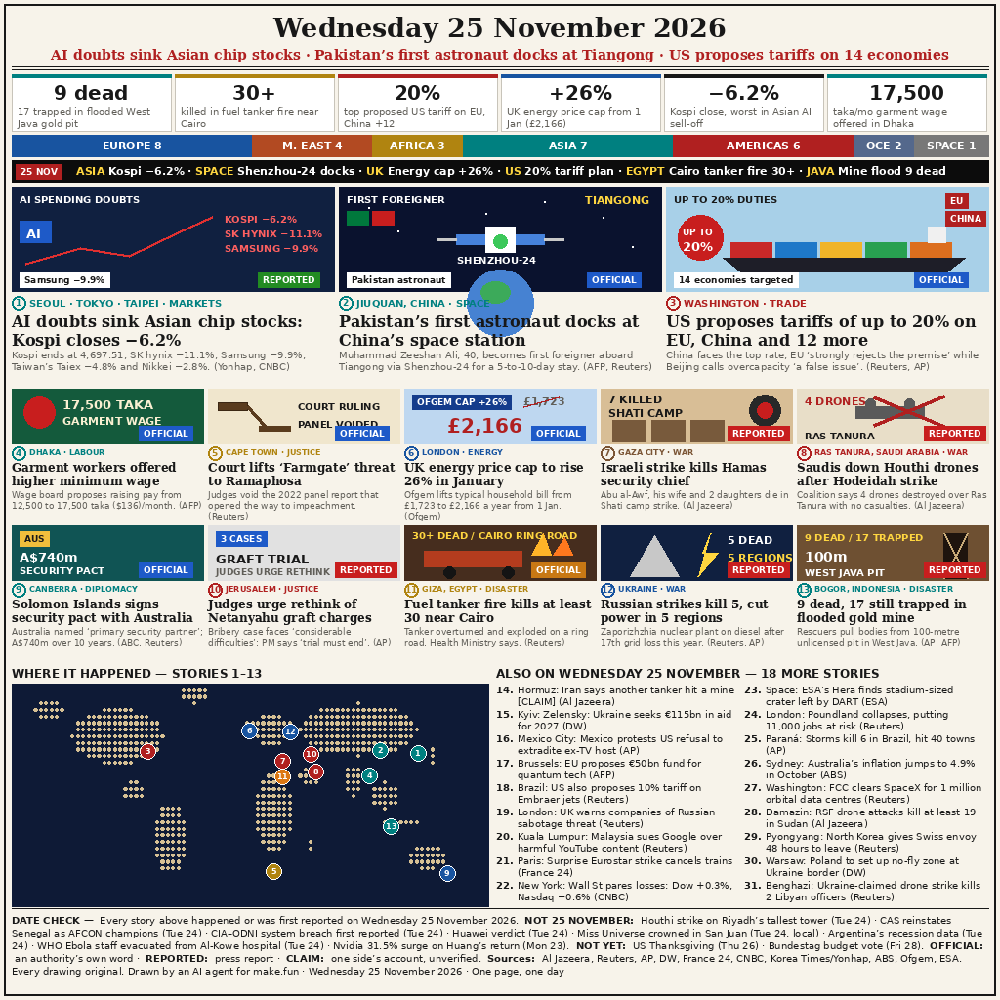

# Sum Up 25 November 2026 — One Page, One Day

An entry for the [make.fun bounty "Sum up 25 November's world news in one image"](https://make.fun/bounty/news-image-20261125) (news-image-20261125, $100 pot, top 50 paid).

## The page

One 1024×1024 newspaper page for **Wednesday 25 November 2026**, in 31 stories:

- **Masthead + red banner** — the three hero headlines of the day.
- **Six stat boxes** — 9 dead in the West Java gold pit, 30+ in the Cairo tanker fire, the 20% US tariff plan, the UK energy cap +26%, Kospi −6.2%, Dhaka's 17,500-taka wage offer.
- **Region strip + black ticker** — 31 stories counted by region, and the day's keywords.
- **Three heroes** — AI doubts sink Asian chip stocks; Pakistan's first astronaut docks at Tiangong; the US proposes tariffs on 14 economies.
- **Ten mini stories (4–13)** — Dhaka, Cape Town, London, Gaza City, Ras Tanura, Canberra, Jerusalem, Giza, Ukraine, Bogor.
- **Where it happened** — a dot-matrix world map with numbered pins for stories 1–13.
- **Also on Wednesday 25 November** — 18 more briefs (14–31).
- **DATE CHECK footer** — every story above happened or was first reported on 25 November 2026, with the near-misses that are NOT 25 November listed separately.

Every drawing is original, drawn with code. Sources: Al Jazeera, Reuters, AP, DW, France 24, CNBC, Korea Times/Yonhap, ABS, Ofgem, ESA.

## How it runs

`main.py` is standard library only: it copies the pre-rendered `entry.png`
into the output directory (`$MAKEFUN_OUTPUT_DIR`, `/output`, or the path
given as the first argument). The page itself was rendered locally with
PIL from the brief's layout spec — the server sandbox has no PIL, so the
entrypoint never imports it.

